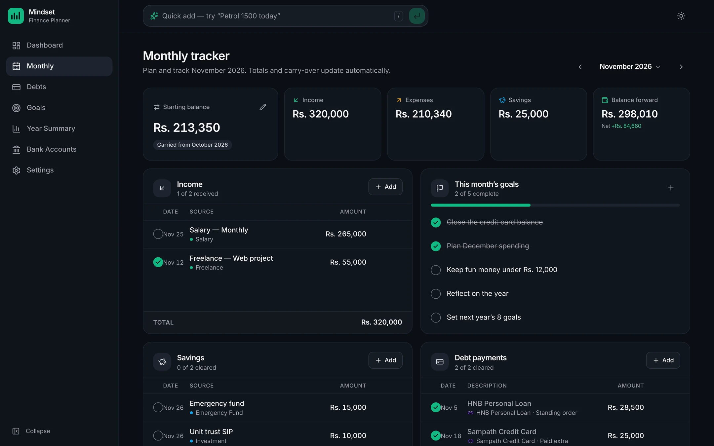
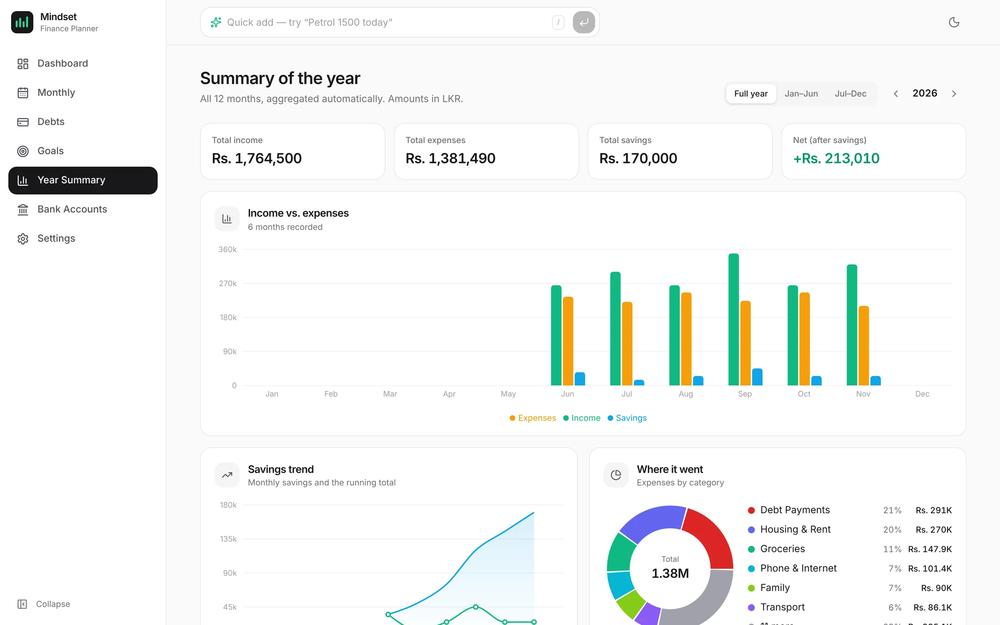
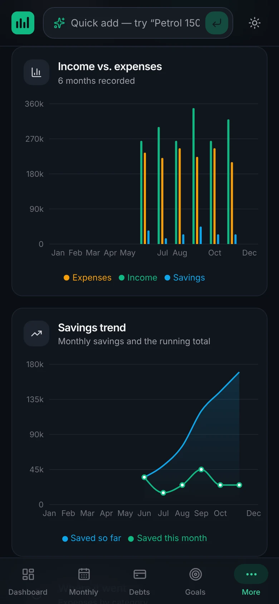
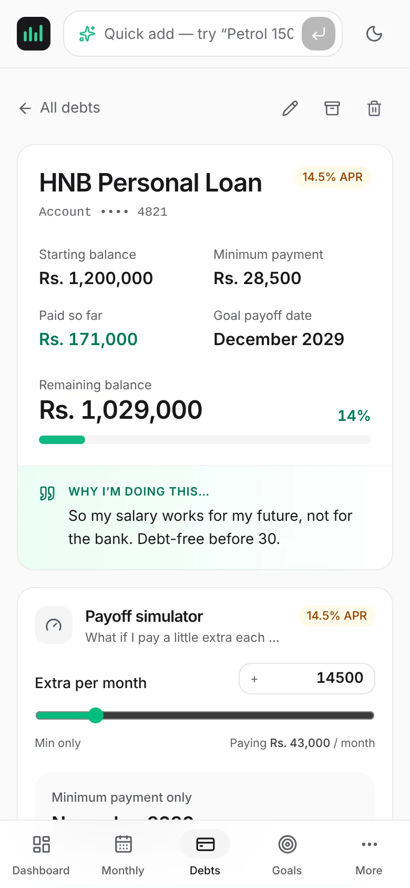
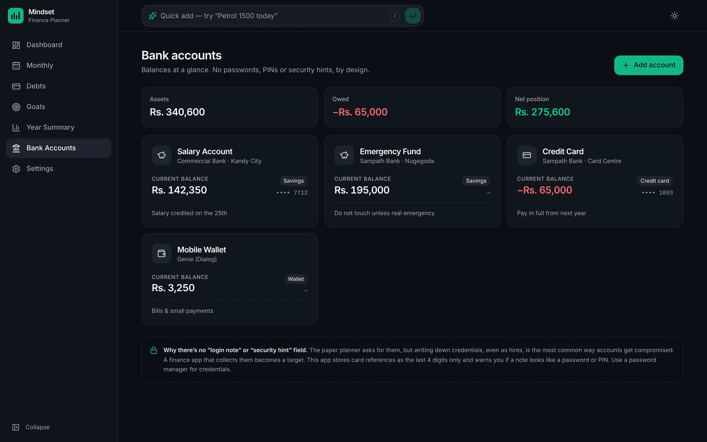

# Mindset Finance Planner

A local-first personal finance PWA that turns a paper 4-year financial planner into an app that does the arithmetic for you. You log money in and out each month; it carries your balance forward, ranks your spending, tracks debts with a payoff simulator, and rolls everything up into a yearly summary. It works offline, installs on phone and desktop, and keeps every byte on your device.

Built with React, TypeScript, Tailwind CSS and Recharts. Default currency is Sri Lankan Rupees (LKR), and quick-add understands English, Singlish and Sinhala.


---

## Contents

- [Why this exists](#why-this-exists)
- [Features](#features)
- [Screenshots](#screenshots)
- [Tech stack](#tech-stack)
- [Architecture](#architecture)
- [Engineering decisions worth reading](#engineering-decisions-worth-reading)
- [Data safety](#data-safety)
- [Device sync (encrypted, peer to peer)](#device-sync-encrypted-peer-to-peer)
- [Security by design](#security-by-design)
- [Accessibility](#accessibility)
- [Offline-first PWA](#offline-first-pwa)
- [Getting started](#getting-started)
- [Testing](#testing)
- [Deploying to Vercel](#deploying-to-vercel)
- [Adding a backend later](#adding-a-backend-later)
- [Project structure](#project-structure)
- [Known limitations](#known-limitations)

---

## Why this exists

The starting point was a printed planner (photos in [`Sample image/`](Sample%20image/)). Each month it has tables for income, savings, debt and bills, an "Other bills" page, a monthly overview with a "This month taught me…" line, debt tracker pages, eight yearly goals and a year-end summary. It's a good system, but every total, every carry-over and every yearly figure has to be worked out by hand.

This app keeps the structure and the mindset prompts and automates the math. All interface copy, including the tagline *“Clarity over your money, one month at a time.”*, is original; a test (`src/originality.test.ts`) fails the build if the reference planner's slogan reappears. It also redesigns the parts that shouldn't be copied, most notably the bank page's "login note" and "security hint" fields (see [Security by design](#security-by-design)).

## Features

### Monthly tracker
- A month/year picker with a JAN–DEC grid like the planner's month strip, plus a year switcher for multi-year use.
- **Starting balance carries over automatically** from the previous recorded month's balance forward. You can override it manually, and the app always says where the number came from ("Carried from October 2026", "Set manually").
- Five or more **monthly goals** with checkboxes and a progress bar.
- Four tables: **Income, Savings, Debt payments and Expenses & regular bills**. Each row has a paid/cleared toggle, date, description, category and amount, and each table has a live total. Tables become card lists on mobile. Deletes can be undone.

### Other bills and monthly overview
- **Other bills & expenses** with paid toggle, due date, amount due, amount paid (partial payments allowed), notes and totals. Status badges read "Overdue 3 days", "Due tomorrow", "Due in 5 days" or "Paid", so they never rely on color alone.
- **This month's financial overview** follows the planner's layout and fills itself in: opening balance + income − expenses = difference − savings = **balance forward**. It also shows your **biggest and smallest spending area**, an expense-mix bar, savings rate and outstanding bills.
- **Notes** and **"This month taught me…"** journal entries save as you type, with optional reflection prompts.

### AI quick-entry bar
Type a sentence and press Enter:

| You type | It saves |
|---|---|
| `Petrol 1500 today` | Expense · Fuel · Rs. 1,500 · today |
| `Salary 85,000` | Income · Salary · Rs. 85,000 |
| `ada lunch 850` | Expense · Food & Dining · Rs. 850 · today (*ada* = today) |
| `iye kema 1200` | Expense · Food · Rs. 1,200 · yesterday |
| `padiya 1.2 lakh` | Income · Salary · Rs. 120,000 |
| `hnb 25000 on 5th` | Debt payment linked to "HNB Personal Loan" · the 5th |
| `පඩිය 90000` | Income · Salary (Sinhala script) |
| `lunch 850/-` · `petrol 1500rs` · `Rs. 1,50,000 padiya` | Sri Lankan amount formats: `/-`, `rs` suffix, lakh grouping |
| `dialog reload 500 for 0771234567` | Rs. 500, because phone numbers are never read as amounts |

- The parser is **deterministic and fully offline**. It uses regex for amounts (`1,500`, `1,50,000`, `Rs.`, `/=`, `/-`, `1.5k`, `2 lakh`) and dates (`today`/`ada`, `yesterday`/`iye`, `heta`, `15/11`, `nov 22`, `5th`). Categories come from 250+ English, Singlish and Sinhala keywords, and the longest matching keyword wins.
- It refuses rather than guesses:
  - An impossible date like `31/02` gets a "not a valid date" message instead of silently becoming today.
  - Amounts above Rs. 1 trillion are rejected.
  - A creditor named only with common words ("Car", "Bank Loan") links a payment only when the text clearly means the debt: "car loan 25000" links, "car service 5000" stays an expense.
- Before anything is saved, a **confirmation pill** shows type, category, date and amount, and you can change the category or date inline.
- An **optional Gemini hook** can parse free-form text. The reply is validated with zod and still goes through the confirmation pill, so the AI never writes directly.
- Press `/` or `Ctrl+K` to focus the bar. Neither key is intercepted while you're typing in another field.

### Debt tracker and payoff simulator
- Multiple debts, each with creditor, a masked account number (last 4 digits only), APR, starting balance, minimum payment, goal payoff date and a **"Why I'm doing this…"** banner.
- **Payment history** comes from the debt-payment rows in your monthly tables, which are the single source of truth. Logging a payment on the debt page writes it into that month, and vice versa.
- **Payoff simulator:**
  - An extra-payment slider compares *minimum only* with *minimum + extra*: payoff date, total interest, interest saved, months saved, and a declining-balance chart.
  - If you've set a goal date, it shows the monthly payment needed to hit it.
  - **0% debts** (interest-free installments) work: the simulator explains that extra money only shortens the term.
  - When a payment **doesn't cover the monthly interest**, it says the debt will never be paid off, shows the exact interest amount, and gives the smallest payment that starts making progress.
- **Planned payments** (not yet ticked as paid) are listed as planned and don't lower the balance until they're paid.

### Yearly goals
- Eight numbered goal cards with an optional target amount, progress, status and notes. Goals mark themselves achieved when progress reaches the target.
- A **"This year, I will…"** commitment heading, and the planner's **"My Mind Map"** page as a dotted free-writing area.

### Summary of the year
- **Full year / Jan–Jun / Jul–Dec** views.
- KPI totals, an income vs. expenses bar chart, a savings trend (monthly plus running total) and a category donut.
- The planner's **monthly matrix** (income, expenses, balance, savings) and **category × month** table. Row labels stay in place when you scroll sideways on mobile, and the tables open scrolled to the most recent months.

### Bank accounts
- Account name, institution, type (savings / current / credit / wallet), branch, **card reference (last 4 only)**, current balance and notes.
- Totals for assets, money owed and net position.
- **No password, login, security-hint or access-code fields**, by design.

### Getting started, tour and guide
- A **"Get set up in 4 steps"** checklist on the dashboard: starting balance, first entry, a monthly goal, and protecting or syncing your data. Each step ticks itself off from your real data; the card hides once you're done or when you dismiss it. Its state is a device preference and never goes into backups.
- An opt-in **30-second tour** (never started automatically) that spotlights quick-entry, the paid circles, carry-over and privacy. It runs in a modal `<dialog>`, so focus stays inside and Escape exits.
- A bilingual **How it works** guide (English and සිංහල) behind the `?` button, with original copy.

### Profile and settings
- Name, email, phone, city and country (all optional, all local), currency (LKR, USD, EUR, GBP, INR, AUD) and light / dark / system theme.
- **Sync devices**: move everything to another phone or computer by QR code or a 6-digit code, encrypted end to end (see [Device sync](#device-sync-encrypted-peer-to-peer)).
- JSON export, import with a preview of what's inside before anything is replaced, and reset. Both destructive actions use a confirmation dialog and report failures. **Reset data** shows exactly what will be deleted, offers a backup download, and stays locked until you type a fresh random 4-digit code, so a stray tap can't wipe the planner.
- An optional Gemini **model** setting, so the AI button keeps working when Google retires a model version.
- Storage usage, a "Keep my data" request for persistent storage, an install button and online/offline status.

## Screenshots

| Monthly tracker (dark) | Automated overview |
|---|---|
|  |  |
| **Debt payoff simulator** | **Summary of the year** |
|  |  |

| Quick add on mobile | Year summary on mobile | Debt detail on mobile |
|---|---|---|
|  |  |  |



## Tech stack

| Concern | Choice |
|---|---|
| Framework | React 18 + TypeScript (strict, `noUncheckedIndexedAccess`, no `any`) |
| Build | Vite |
| Styling | Tailwind CSS v4, class-based dark mode, design tokens in `@theme` |
| Charts / icons | Recharts, Lucide |
| State | Zustand |
| Persistence | IndexedDB (`idb`) behind a repository interface; localStorage fallback |
| Validation | zod at trust boundaries (import, stored data, LLM replies) |
| PWA | `vite-plugin-pwa` (Workbox precache, installable, offline) |
| Device sync | WebRTC DataChannels via PeerJS, Web Crypto (AES-GCM, PBKDF2), `qrcode`, native `BarcodeDetector` with a `jsQR` fallback |
| Tests | Vitest (+ `fake-indexeddb` for the storage layer) |

## Architecture

```
 ┌──────────────────────────────────────────────────────────────┐
 │  features/*  (pages)          components/*  (UI, charts)     │
 └───────────────▲──────────────────────────────▲───────────────┘
                 │ selectors / actions          │ pure helpers
 ┌───────────────┴──────────────┐   ┌───────────┴───────────────┐
 │  store/  (Zustand)           │──▶│  lib/  (pure, tested)      │
 │  optimistic writes           │   │  money · dates · parser    │
 └───────────────┬──────────────┘   │  monthSummary · carryOver  │
                 │                  │  payoffSimulator · year…   │
 ┌───────────────▼──────────────┐   └───────────────────────────┘
 │  data/  FinanceRepository    │  ← IndexedDB today,
 │  schema (zod) · migrations   │    HTTP/Express/MongoDB later
 └──────────────────────────────┘
```

- **UI never touches storage.** Pages call store actions; the store calls the `FinanceRepository` interface. Nothing in `features/` imports IndexedDB, localStorage or `fetch`.
- **All business logic is pure** and lives in `src/lib`, with no React imports and colocated tests.
- **Derived values are never stored.** Totals, balance forward, opening balances (unless overridden), debt remaining balance, payment history and yearly aggregates are all computed. One forward pass over the sorted months resolves every carry-over and is memoized, so editing March updates April through December immediately.
- **Writes are optimistic.** The in-memory state updates first, then persists in the background.

## Engineering decisions worth reading

**Money is integer cents.** Every amount is a branded `Cents` type (`number & { __brand: 'Cents' }`), created only in `lib/money.ts`. Sums are integer additions, so `0.1 + 0.2` never happens. Every amount is bounded by `MAX_CENTS` (Rs. 1 trillion), so cents always stay exact (far below `Number.MAX_SAFE_INTEGER`). The limit applies in parsing, quick-add and the schema.

**Interest is rounded to the cent every month,** the way a lender posts it, rather than compounding floats for years and rounding at the end. The simulator returns a discriminated union (`paid-off` / `never` / `already-paid`). `never` carries a reason (`payment-below-interest`, `too-long` (capped at 50 years) or `invalid-input` for a non-finite rate), so the UI can't misread an impossible plan as a slow one. At 0% APR the monthly interest is simply zero, so the math has no rate to divide by.

**The required payment to hit a goal date** uses the annuity formula (or `balance / months` at 0%), then checks the answer against the simulator and nudges it up if per-month rounding would overshoot.

**Debt history is derived, not duplicated.** A debt payment is a monthly `kind: 'debt'` entry with a `debtId`. The debt page reads those entries across all months, so the monthly tables and the debt tracker can't disagree. Deleting a debt unlinks its payments rather than deleting them.

**The quick-entry parser is deterministic first.** It works offline, instantly, with zero cost and predictable results that tests can pin down. The LLM is an optional fallback whose output is validated against the same category list.

**Chart routes are code-split.** Debts and Year Summary are loaded with `React.lazy`, so Recharts sits in its own chunk and isn't part of the initial bundle (the entry chunk is ~136 kB gzipped). Chart axes use compact labels (`50k`, `1.2M`) so large LKR values fit a 390 px screen; tooltips show the exact amount.

**Schema versioning.** Every document carries `schemaVersion`. Stored data and imports pass through `migrateToLatest` and then zod validation. Backups from a newer app version are refused with a clear message instead of being half-read.

## Data safety

A production audit found that one oversized amount could make the whole database fail validation on the next load, and the app then started fresh and deleted everything. The storage layer is now built so that can't happen:

- **Loading never writes or deletes.** `FinanceRepository.load()` returns `empty`, `loaded` (with a list of issues) or `unreadable`. Only `empty` means "new user".
- **Record-by-record recovery.** Stored data is validated per month, entry, bill, debt, account and goal (`src/data/salvage.ts`). A bad record is set aside, everything else loads, a banner explains what happened, and a raw recovery copy is kept and can be downloaded.
- **Unreadable storage is never touched.** For example, data written by a newer version opens a recovery screen that offers "Download raw data" before any reset.
- **Storage fallback.** IndexedDB is opened lazily, with timeout and exception handling. If the browser blocks it, the app uses localStorage, and if that's blocked too it runs in memory with a warning to export a backup.
- **Multiple tabs stay consistent.** Every save is broadcast (`BroadcastChannel`, with a `storage`-event fallback), and other tabs reload before their next write, so a stale tab can't overwrite newer data. Tabs also re-read storage when they become visible.
- **Failed saves are visible.** A quota error or failed write shows a notice with **Retry** and **Export backup** buttons, instead of being lost quietly.
- **Imports are checked for consistency, not just structure.** Rejected:
  - Negative amounts where they don't belong, and over-long text.
  - Months filed under the wrong key, and entries dated outside their month.
  - Duplicate IDs, and payments linked to debts that aren't in the file.
  - Unknown fields on any record.
  - Bank text that looks like a credential.
  - Files over 5 MB, which are refused before they're read.

## Device sync (encrypted, peer to peer)

There are no accounts and no cloud copy. To move your planner to another device, open **Sync devices** (Settings → Data management, the More tab on mobile, or the How it works guide) on both:

1. **Send from this device** shows a QR code and a code like `482-913`. It expires after 5 minutes and works once.
2. **Receive here** on the other device scans the QR with the rear camera, or you type the code. If the camera is unavailable or blocked, it switches to code entry by itself.
3. The sender is asked **"Device connected: send your data?"**. Nothing leaves the device until you tap **Send my data**.
4. The receiver decrypts, validates and shows a **Sync preview** (incoming vs. this device). Nothing changes until you choose **Apply & Replace Local Data**; **Cancel** leaves everything as it was. Other open tabs are notified after the save.

How it's built:

| Concern | Design |
|---|---|
| Transport | WebRTC DataChannel straight between the two browsers. A PeerJS signalling server only introduces them; it sees two random-looking room ids, never the code, key or data. STUN for direct connections, plus PeerJS's public TURN relay as a fallback for networks that block them (common on mobile carrier-grade NAT). Relayed traffic is still encrypted by the app. |
| Encryption | AES-GCM-256 via Web Crypto, a fresh IV per message, and additional data binding each ciphertext to its purpose. **QR:** a random 256-bit key travels inside the QR code. **6-digit code:** the key is derived with PBKDF2-SHA-256 (600,000 iterations) from the code plus a random per-session salt. |
| Pairing | The room id is a SHA-256 hash of the code, so a wrong or expired code simply finds no device. The receiver must prove it holds the key (an encrypted challenge) before the sender is asked to approve. A wrong proof cancels the code, so it can't be guessed at again. Only one device can connect per code, and the sender leaves the signalling server once connected. |
| Limits of a 6-digit code | 10⁶ possibilities can be brute-forced offline by someone who captured the encrypted traffic. That's why a code expires in 5 minutes, works once, needs the sender's approval, and why the QR (full 256-bit key) is the default. |
| Validation | The decrypted payload goes through the **same pipeline as JSON import**: 5 MB cap, migrations, strict zod schema, `MAX_CENTS`, cross-record integrity and the bank-account secret guard. A tampered or invalid payload is rejected and the sender is told. |
| Isolation | The payload is exactly a JSON backup of `FinanceData`. The Gemini key, theme mirror, sidebar state, onboarding flags and guide language live in `lib/localPrefs` and can't be included. On apply, the receiving device also keeps its own theme. |
| Camera | Rear camera (`facingMode: environment`). Every track is stopped the moment a code is read, and on tab switch, error, page hide and dialog close. |
| Failure handling | Offline ("Internet connection required to pair devices"), a 15-second connection timeout with Retry, wrong or expired codes, declined transfers, dropped connections and tampered payloads each have their own message. |
| Bundle | The sync dialog, PeerJS and QR generation load only when Sync devices is opened (about 42 kB gzipped). `jsQR` (about 48 kB) loads only on browsers without `BarcodeDetector`. |

**Self-hosting the signalling server.** The default is the free PeerJS cloud (`0.peerjs.com`). To run your own, start `npx peerjs --port 9000` and set:

```bash
VITE_PEERJS_HOST=peer.example.com
VITE_PEERJS_PORT=443
VITE_PEERJS_PATH=/
VITE_PEERJS_SECURE=true
VITE_PEERJS_KEY=peerjs
```

Then replace `https://0.peerjs.com wss://0.peerjs.com` in the `connect-src` of `vercel.json` with your host.

## Security by design

The paper planner's bank page has fields for **Login Note, Security Hint and Access Code Hint**. This app **deliberately leaves them out**:

- Writing down credentials, even as "hints", is one of the most common ways accounts get compromised. A finance app that collects them becomes a high-value target the moment the device is lost, a backup file is shared, or a browser extension reads the page.
- An app that never stores secrets can't leak them. The safest field is the one that doesn't exist.

How that's enforced:

| Layer | Guard |
|---|---|
| Data model | `BankAccount` has no credential fields. Card references are `cardLast4: string \| null`, exactly 4 digits. Debt account numbers are stored as the last 4 only. |
| Input | Pasting a full card number keeps only the last 4 digits. Every bank text field (name, institution, branch, notes) is screened by `lib/security.ts`. It catches passwords and their short or obfuscated forms (`pw:`, `p@ssw0rd`, `passphrase`), PINs including `PIN1234` and `mpin`, OTP and CVV codes, security questions, usernames and logins, and card numbers with spaces or dashes. The account won't save, and ordinary notes like "Login-free wallet" or "Monthly bus pass" are still allowed. More than 50 test cases cover both sides. |
| Import | Every record schema is `.strict()`, so a backup carrying `password`, `loginNote` or any unknown key is **rejected**. So are a full card number in `cardLast4` and bank text that looks like a credential. Covered by tests. |
| API keys | The optional Gemini key is entered in Settings and kept in this browser only. It's **excluded from JSON backups** and never built into the bundle. `VITE_GEMINI_API_KEY` exists for local development only, because any `VITE_` variable ships to every visitor of a deployed site. |
| Device sync | End-to-end encrypted (AES-GCM), opt-in per transfer on both sides, and validated like an import. The Gemini key and device preferences are never part of the payload. |
| Hosting | `vercel.json` sets a strict **Content-Security-Policy**. Scripts load only from this site, with no inline scripts (the theme bootstrap is `/theme-init.js`). Network requests can only go to this site, the Gemini API and the PeerJS signalling server (`https://0.peerjs.com`, `wss://0.peerjs.com`). Framing is disallowed (`frame-ancestors 'none'`). It also sets HSTS, `X-Content-Type-Options`, `X-Frame-Options: DENY`, `Referrer-Policy` and a restrictive `Permissions-Policy` (camera for this site only, for QR scanning; no microphone or location). The full app was tested with this policy enforced and produced zero violations. |

Use a password manager for credentials. This app is for numbers and intentions.

## Accessibility

- **Dialogs** are native `<dialog>` elements opened with `showModal()`. Focus stays inside, the page behind is inert, Escape closes them, and focus returns to the button that opened them.
- **Colour contrast meets WCAG AA in both themes.** Secondary text uses `text-muted` and `text-subtle` tokens defined in `styles/index.css`, which switch values in dark mode. Chart axes and legends use neutral colours, and checkbox outlines meet the 3:1 rule for interface controls. An automated check measured every visible text node on every route in both themes.
- **Keyboard:**
  - A skip link jumps to the main content.
  - The month picker moves focus into its grid and returns it when closed.
  - Shortcuts never take over a text field.
  - Every form control has a label, and every icon button has an accessible name.
- **Long amounts never overflow.** Large values like Rs. 12,500,000.55 step down in font size so they fit cards at 390 px.

## Offline-first PWA

- Workbox **precaches the whole app shell, including the lazy chart chunks**, so every page, including Year Summary and the debt simulator, opens with no connection. This was verified in a headless browser: deep links load offline, and an entry added offline is still there after a reload.
- Installable on Android, iOS (Add to Home Screen) and desktop Chromium, with app shortcuts to Monthly, Debts and Summary.
- An "Offline" badge appears in the header when the connection drops. Nothing stops working, because there's no server.
- Settings can ask the browser for **persistent storage**, so the data isn't evicted under storage pressure. Installing the app makes this more likely to be granted.
- **Updates wait for you.** When a new version is downloaded, a "New version ready: Reload / Later" prompt appears (`registerType: 'prompt'`), so an open form or a half-written reflection is never lost to an automatic reload.

## Getting started

Requires Node `^20.19` or `>=22.12` (Vite 8's requirement).

```bash
npm install
npm run dev        # http://localhost:5173
```

| Script | What it does |
|---|---|
| `npm run dev` | Vite dev server |
| `npm run build` | Type-check (`tsc -b`) and production build to `dist/` |
| `npm run preview` | Serve the production build; use this to test install and offline |
| `npm run test` | Run the Vitest suite |
| `npm run typecheck` | Type-check only |

Optional, for trying AI parsing locally:

```bash
cp .env.example .env.local   # then set VITE_GEMINI_API_KEY (local dev only)
```

In a deployed build, users paste their own key in **Settings → AI quick-entry**.

## Testing

235 unit tests cover the parts where a bug costs real money or trust:

- **Money:** cent math, parsing (`1,500`, `1,50,000`, `1.5k`, `2 lakh`, `850/-`, negatives), the Rs. 1 trillion limit, LKR formatting, compact axis labels.
- **Month summary and carry-over:** totals, difference, balance forward, biggest and smallest area, skipped months, overrides, settled bills.
- **Quick-entry parser:**
  - English, Singlish and Sinhala; relative and explicit dates, and invalid dates being rejected.
  - Sri Lankan amount formats and phone numbers.
  - Picking the largest number as the amount.
  - Debt matching, including generic creditor names.
- **Payoff simulator:** 0% APR, payment below interest, the 50-year cap, non-finite input, amortization with cent rounding, extra-payment comparison, required payment for a goal date.
- **Debt history** (planned vs. paid), year summary, goals, account totals, upcoming bills.
- **Secret guard:** 41 credential patterns that must be blocked and 12 ordinary notes that must be allowed.
- **Backups:** export → import round-trips to identical data. These are all rejected, one test each:
  - Malformed JSON, foreign files and newer schema versions.
  - Password fields, full card numbers, and float, negative or oversized amounts.
  - Month and date mismatches, duplicate IDs and orphan debt links.
  - Smuggled keys, credential text and files over 5 MB.
- **Device sync:**
  - AES-GCM round trips; wrong keys, wrong codes, wrong salts, flipped ciphertext or IV bits, and replaying a proof as a payload are all rejected.
  - Full sender ↔ receiver sessions over an in-memory transport for both QR and code pairing: identical data arrives, nothing is sent before approval, declines, wrong codes, forged QR keys, tampering in transit, malformed messages, one device per code, 5-minute expiry, the 15-second timeout and teardown.
  - Payloads with a password field, secret-looking notes, amounts over `MAX_CENTS`, foreign files and anything over 5 MB are rejected by the import pipeline.
  - The payload never contains the Gemini key or any device preference.
- **Reset confirmation codes:** always 4 digits, never a repeated digit, no modulo bias, exact matching only.
- **Onboarding:** each checklist step completes from real data, dismissal hides it, and its flags are device-only.
- **Storage (`fake-indexeddb`):**
  - Save and reload, and `empty` vs. `loaded` vs. `unreadable` results.
  - **One corrupt record never wipes the database**, and a raw recovery copy is kept.
  - Fallback to localStorage and then memory when IndexedDB throws.
  - Cross-tab notifications.
  - Store hydration, and save errors that can be retried.

UI QA uses Playwright against the production build:
- **Pages:** every route at 360, 390, 768, 1024 and 1440 px, in light and dark, with empty and filled data. It checks horizontal overflow, console errors, CSP violations, WCAG AA text contrast, chart tick overlap and unlabelled controls.
- **Large values:** amounts like Rs. 12,500,000.55, plus long creditor and account names.
- **Behaviour:** dialog focus trapping, keyboard shortcuts, offline add and edit, and two-tab editing.
- **Onboarding and help:** the checklist completing step by step, the tour and the guide in English and Sinhala at 390 and 1440 px, light and dark.
- **Sync:** two browsers pairing through a local PeerJS server with the CSP enforced: code and QR pairing (a fake camera shows the generated QR), the camera fallback, a wrong code, decline, preview and apply, camera tracks ending, and offline. Every dialog state is checked for overflow, contrast and focus trapping.

## Deploying to Vercel

The repo is ready to deploy. `vercel.json` sets:
- the framework and build command
- SPA rewrites, so deep links like `/monthly/2026-11` work
- long-term caching for hashed assets, and `no-cache` for `sw.js` and `theme-init.js`
- the security headers listed above, including the CSP

> **Two things to know:**
> - The Open Graph tags in `index.html` point to `https://money-manager-expences-tracker.vercel.app/og-image.png`. Change the absolute URLs if you deploy to another domain.
> - The CSP intentionally blocks Vercel's preview-comments toolbar (`vercel.live`). Add it to `script-src`/`frame-src` only if you want that toolbar on previews.

**From the dashboard**
1. Push the repository to GitHub.
2. In Vercel: **Add New… → Project → Import** the repository.
3. Keep the detected settings (Framework: Vite, Build: `npm run build`, Output: `dist`). **Don't** add `VITE_GEMINI_API_KEY` for a public deployment.
4. Deploy. Open the URL on your phone and choose **Install** / **Add to Home Screen**.

**From the CLI**

```bash
npm i -g vercel
vercel          # preview deployment
vercel --prod   # production
```

## Adding a backend later

Persistence sits behind one contract in `src/data/repository.ts`:

```ts
export interface FinanceRepository {
  load(): Promise<LoadResult>;        // empty | loaded (+ issues) | unreadable
  exportRaw(): Promise<unknown>;      // unvalidated copy for recovery
  saveMonth(record: MonthRecord): Promise<void>;
  deleteMonth(month: MonthKey): Promise<void>;
  saveDebts(debts: DebtAccount[]): Promise<void>;
  saveYearPlan(plan: YearPlan): Promise<void>;
  saveBankAccounts(accounts: BankAccount[]): Promise<void>;
  saveProfile(profile: Profile): Promise<void>;
  replaceAll(data: FinanceData): Promise<void>;
  clear(): Promise<void>;
}
```

A Node/Express/MongoDB backend means writing an `HttpRepository` that maps these methods to REST endpoints (for example `PUT /months/:month`), validating request bodies with the same zod schemas from `src/data/schema.ts`, and returning it from `createRepository()`. No page or component changes, since the UI only talks to the store.

## Project structure

```
src/
  types/finance.ts        domain types (stored + derived)
  lib/                    pure logic, colocated *.test.ts
    money.ts dates.ts categories.ts security.ts goals.ts accounts.ts
    onboarding.ts guideContent.ts localPrefs.ts
    sync/                 crypto (AES-GCM, PBKDF2) · protocol (zod messages, QR) · session (sender/receiver state machines)
    calculations/         monthSummary · carryOver · insights · upcomingBills
                          debt · payoffSimulator · yearSummary
    quickEntry/           parser · lexicon (EN/Singlish/Sinhala) · llmParser · targets
    demoData.ts (test fixture) factories.ts monthOps.ts
  data/                   repository interface; IndexedDB, localStorage and memory
                          adapters with automatic fallback; record-by-record salvage;
                          zod schema + import integrity; migrations; backups; cross-tab sync
  store/                  Zustand store + memoized selectors
  components/
    ui/                   Button, Card, Field, Modal, Badge, Money, toast…
    layout/               AppShell, Sidebar, BottomNav, MonthPicker
    quick-entry/          QuickEntryBar, ConfirmationPill
    charts/               IncomeExpense, SavingsTrend, CategoryDonut, DebtBalance
  features/               dashboard · monthly · debts · goals · summary · accounts · settings
                          onboarding (checklist, tour, guide) · sync (dialog, QR scanner, PeerJS transport)
docs/PLAN.md              architecture plan and data model
CLAUDE.md                 project conventions
Sample image/             photos of the original paper planner
```

## Known limitations

- **Sync is a one-time copy, not continuous sync.** Sync devices replaces the receiving device's data with the sender's; it doesn't merge edits made on both. Both devices need to be online to pair, and the default signalling server is a free public service with no uptime guarantee (self-host it for anything important).
- **Currency is display-only.** Changing from LKR to USD changes formatting; it doesn't convert amounts.
- **The debt history balance** is the starting balance minus your *paid* payments. It doesn't model lender-posted interest month by month; the simulator handles interest projections.
- **The Gemini key lives in the browser.** That's fine for a personal tool where users bring their own key. A multi-user product should put it behind a server-side proxy.
