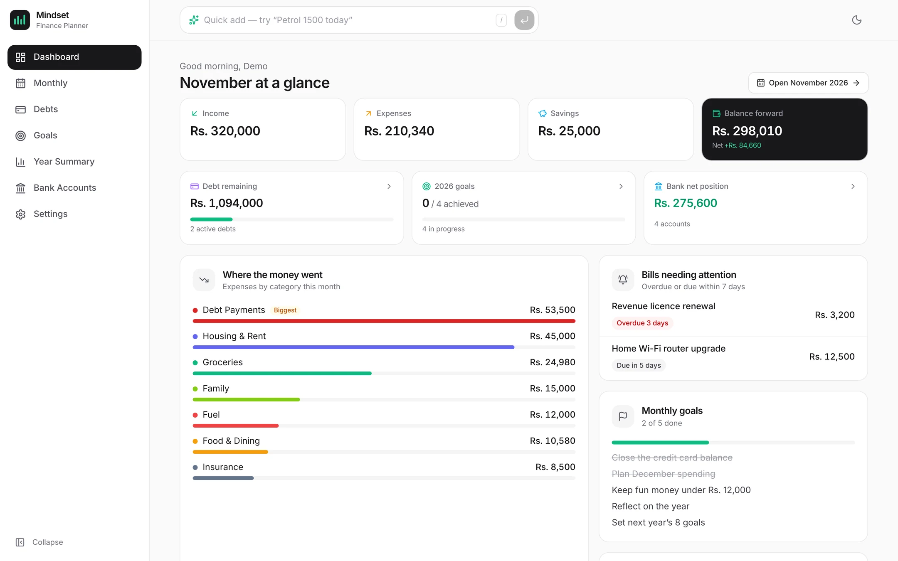
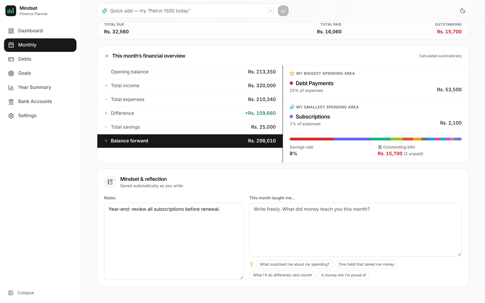
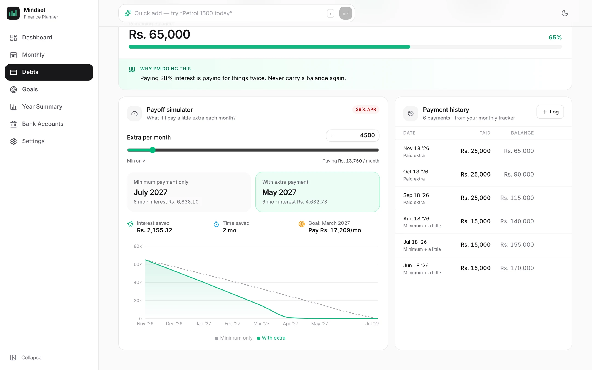
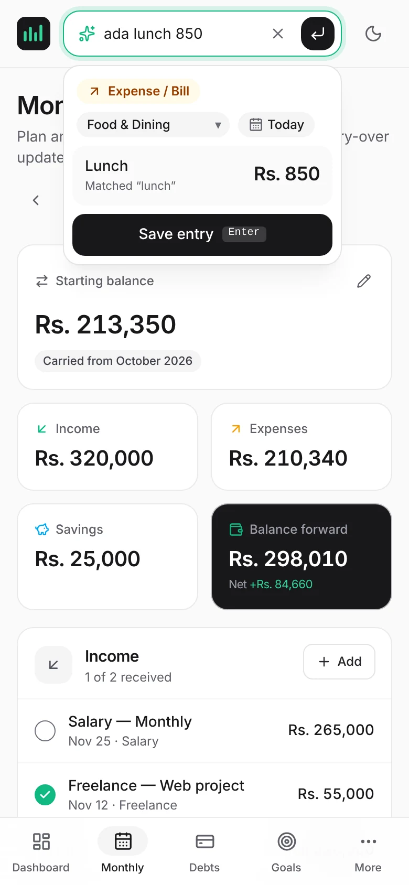

# Mindset Finance Planner

A local-first personal finance PWA that turns a paper 4-year financial planner into an app that does the arithmetic for you. You log money in and out each month; it carries your balance forward, ranks your spending, tracks debts with a payoff simulator, and rolls everything up into a yearly summary. It works offline, installs on phone and desktop, and keeps every byte on your device.

Built with React, TypeScript, Tailwind CSS and Recharts. Default currency is Sri Lankan Rupees (LKR), and quick-add understands English, Singlish and Sinhala.



> **Try it in 30 seconds:** open the app and press **Load sample data**. You get six months of realistic LKR data, two debts, four yearly goals, bank accounts and monthly reflections, so every chart and calculation has something to show.

---

## Contents

- [Why this exists](#why-this-exists)
- [Features](#features)
- [Screenshots](#screenshots)
- [Tech stack](#tech-stack)
- [Architecture](#architecture)
- [Engineering decisions worth reading](#engineering-decisions-worth-reading)
- [Security by design](#security-by-design)
- [Offline-first PWA](#offline-first-pwa)
- [Getting started](#getting-started)
- [Testing](#testing)
- [Deploying to Vercel](#deploying-to-vercel)
- [Adding a backend later](#adding-a-backend-later)
- [Project structure](#project-structure)
- [Known limitations](#known-limitations)

---

## Why this exists

The starting point was a printed planner (photos in [`Sample image/`](Sample%20image/)). Each month it has tables for income, savings, debt and bills, an "Other bills" page, a monthly overview with a "This month taught me…" line, debt tracker pages, eight yearly goals and a year-end summary. It's a good system, but every total, every carry-over and every yearly figure has to be worked out by hand.

This app keeps the structure and the mindset prompts and automates the math. It also redesigns the parts that shouldn't be copied, most notably the bank page's "login note" and "security hint" fields (see [Security by design](#security-by-design)).

## Features

### Monthly tracker
- A month/year picker with a JAN–DEC grid like the planner's month strip, plus a year switcher for multi-year use.
- **Starting balance carries over automatically** from the previous recorded month's balance forward. You can override it manually, and the app always says where the number came from ("Carried from October 2026", "Set manually").
- Five or more **monthly goals** with checkboxes and a progress bar.
- Four tables: **Income, Savings, Debt payments and Expenses & regular bills**. Each row has a paid/cleared toggle, date, description, category and amount, and each table has a live total. Tables become card lists on mobile. Deletes can be undone.

### Other bills and monthly overview
- **Other bills & expenses** with paid toggle, due date, amount due, amount paid (partial payments allowed), notes and totals. Status badges read "Overdue 3 days", "Due tomorrow", "Due in 5 days" or "Paid", so they never rely on color alone.
- **This month's financial overview** follows the planner's layout and fills itself in: opening balance + income − expenses = difference − savings = **balance forward**. It also shows your **biggest and smallest spending area**, an expense-mix bar, savings rate and outstanding bills.
- **Notes** and **"This month taught me…"** journal entries save as you type, with optional reflection prompts.

### AI quick-entry bar
Type a sentence and press Enter:

| You type | It saves |
|---|---|
| `Petrol 1500 today` | Expense · Fuel · Rs. 1,500 · today |
| `Salary 85,000` | Income · Salary · Rs. 85,000 |
| `ada lunch 850` | Expense · Food & Dining · Rs. 850 · today (*ada* = today) |
| `iye kema 1200` | Expense · Food · Rs. 1,200 · yesterday |
| `padiya 1.2 lakh` | Income · Salary · Rs. 120,000 |
| `hnb 25000 on 5th` | Debt payment linked to "HNB Personal Loan" · the 5th |
| `පඩිය 90000` | Income · Salary (Sinhala script) |

- The parser is **deterministic and fully offline**. It uses regex for amounts (`1,500`, `Rs.`, `/=`, `1.5k`, `2 lakh`) and dates (`today`/`ada`, `yesterday`/`iye`, `heta`, `15/11`, `nov 22`, `5th`). Categories come from 250+ English, Singlish and Sinhala keywords, and the longest matching keyword wins.
- Before anything is saved, a **confirmation pill** shows type, category, date and amount, and you can change the category or date inline.
- An **optional Gemini hook** can parse free-form text. The reply is validated with zod and still goes through the confirmation pill, so the AI never writes directly.
- Press `/` or `Ctrl+K` anywhere to focus the bar.

### Debt tracker and payoff simulator
- Multiple debts, each with creditor, a masked account number (last 4 digits only), APR, starting balance, minimum payment, goal payoff date and a **"Why I'm doing this…"** banner.
- **Payment history** comes from the debt-payment rows in your monthly tables, which are the single source of truth. Logging a payment on the debt page writes it into that month, and vice versa.
- **Payoff simulator:**
  - An extra-payment slider compares *minimum only* with *minimum + extra*: payoff date, total interest, interest saved, months saved, and a declining-balance chart.
  - If you've set a goal date, it shows the monthly payment needed to hit it.
  - **0% debts** (interest-free installments) work: the simulator explains that extra money only shortens the term.
  - When a payment **doesn't cover the monthly interest**, it says the debt will never be paid off, shows the exact interest amount, and gives the smallest payment that starts making progress.

### Yearly goals
- Eight numbered goal cards with an optional target amount, progress, status and notes. Goals mark themselves achieved when progress reaches the target.
- A **"This year, I will…"** commitment heading, and the planner's **"My Mind Map"** page as a dotted free-writing area.

### Summary of the year
- **Full year / Jan–Jun / Jul–Dec** views.
- KPI totals, an income vs. expenses bar chart, a savings trend (monthly plus running total) and a category donut.
- The planner's **monthly matrix** (income, expenses, balance, savings) and **category × month** table. Row labels stay in place when you scroll sideways on mobile, and the tables open scrolled to the most recent months.

### Bank accounts
- Account name, institution, type (savings / current / credit / wallet), branch, **card reference (last 4 only)**, current balance and notes.
- Totals for assets, money owed and net position.
- **No password, login, security-hint or access-code fields**, by design.

### Profile and settings
- Name, email, phone, city and country (all optional, all local), currency (LKR, USD, EUR, GBP, INR, AUD) and light / dark / system theme.
- JSON export, import with a preview of what's inside before anything is replaced, load sample data, and reset.
- Storage usage, a "Keep my data" request for persistent storage, an install button and online/offline status.

## Screenshots

| Monthly tracker (dark) | Automated overview |
|---|---|
|  |  |
| **Debt payoff simulator** | **Summary of the year** |
|  |  |

| Quick add on mobile | Year summary on mobile | Debt detail on mobile |
|---|---|---|
|  |  |  |


## Tech stack

| Concern | Choice |
|---|---|
| Framework | React 18 + TypeScript (strict, `noUncheckedIndexedAccess`, no `any`) |
| Build | Vite |
| Styling | Tailwind CSS v4, class-based dark mode, design tokens in `@theme` |
| Charts / icons | Recharts, Lucide |
| State | Zustand |
| Persistence | IndexedDB (`idb`) behind a repository interface; localStorage fallback |
| Validation | zod at trust boundaries (import, stored data, LLM replies) |
| PWA | `vite-plugin-pwa` (Workbox precache, installable, offline) |
| Tests | Vitest (+ `fake-indexeddb` for the storage layer) |

## Architecture

```
 ┌──────────────────────────────────────────────────────────────┐
 │  features/*  (pages)          components/*  (UI, charts)     │
 └───────────────▲──────────────────────────────▲───────────────┘
                 │ selectors / actions          │ pure helpers
 ┌───────────────┴──────────────┐   ┌───────────┴───────────────┐
 │  store/  (Zustand)           │──▶│  lib/  (pure, tested)      │
 │  optimistic writes           │   │  money · dates · parser    │
 └───────────────┬──────────────┘   │  monthSummary · carryOver  │
                 │                  │  payoffSimulator · year…   │
 ┌───────────────▼──────────────┐   └───────────────────────────┘
 │  data/  FinanceRepository    │  ← IndexedDB today,
 │  schema (zod) · migrations   │    HTTP/Express/MongoDB later
 └──────────────────────────────┘
```

- **UI never touches storage.** Pages call store actions; the store calls the `FinanceRepository` interface. Nothing in `features/` imports IndexedDB, localStorage or `fetch`.
- **All business logic is pure** and lives in `src/lib`, with no React imports and colocated tests.
- **Derived values are never stored.** Totals, balance forward, opening balances (unless overridden), debt remaining balance, payment history and yearly aggregates are all computed. One forward pass over the sorted months resolves every carry-over and is memoized, so editing March updates April through December immediately.
- **Writes are optimistic.** The in-memory state updates first, then persists in the background.

## Engineering decisions worth reading

**Money is integer cents.** Every amount is a branded `Cents` type (`number & { __brand: 'Cents' }`), created only in `lib/money.ts`. Sums are integer additions, so `0.1 + 0.2` never happens. The import schema rejects non-integer amounts.

**Interest is rounded to the cent every month,** the way a lender posts it, rather than compounding floats for years and rounding at the end. The simulator returns a discriminated union (`paid-off` / `never` / `already-paid`). `never` carries a reason (`payment-below-interest` or `too-long`, capped at 50 years), so the UI can't misread an impossible plan as a slow one. At 0% APR the monthly interest is simply zero, so the math has no rate to divide by.

**The required payment to hit a goal date** uses the annuity formula (or `balance / months` at 0%), then checks the answer against the simulator and nudges it up if per-month rounding would overshoot.

**Debt history is derived, not duplicated.** A debt payment is a monthly `kind: 'debt'` entry with a `debtId`. The debt page reads those entries across all months, so the monthly tables and the debt tracker can't disagree. Deleting a debt unlinks its payments rather than deleting them.

**The quick-entry parser is deterministic first.** It works offline, instantly, with zero cost and predictable results that tests can pin down. The LLM is an optional fallback whose output is validated against the same category list.

**Chart routes are code-split.** Debts and Year Summary are loaded with `React.lazy`, so Recharts sits in its own chunk and isn't part of the initial bundle (the entry chunk is ~130 kB gzipped). Chart axes use compact labels (`50k`, `1.2M`) so large LKR values fit a 390 px screen; tooltips show the exact amount.

**Schema versioning.** Every document carries `schemaVersion`. Stored data and imports pass through `migrateToLatest` and then zod validation. Backups from a newer app version are refused with a clear message instead of being half-read.

## Security by design

The paper planner's bank page has fields for **Login Note, Security Hint and Access Code Hint**. This app **deliberately leaves them out**:

- Writing down credentials, even as "hints", is one of the most common ways accounts get compromised. A finance app that collects them becomes a high-value target the moment the device is lost, a backup file is shared, or a browser extension reads the page.
- An app that never stores secrets can't leak them. The safest field is the one that doesn't exist.

How that's enforced:

| Layer | Guard |
|---|---|
| Data model | `BankAccount` has no credential fields. Card references are `cardLast4: string \| null`, exactly 4 digits. Debt account numbers are stored as the last 4 only. |
| Input | Pasting a full card number keeps only the last 4 digits. Notes, names and branch fields are screened (`lib/security.ts`): text that looks like a password, PIN, OTP, login or a 12–19 digit number shows a warning and the account won't save. |
| Import | The bank-account schema is `.strict()`, so a backup carrying `password`, `pin` or any unknown key is **rejected**, as is a full card number in `cardLast4`. Covered by tests. |
| API keys | The optional Gemini key is entered in Settings and kept in this browser only. It's **excluded from JSON backups** and never built into the bundle. `VITE_GEMINI_API_KEY` exists for local development only, because any `VITE_` variable ships to every visitor of a deployed site. |
| Hosting | `vercel.json` sets `X-Content-Type-Options`, `X-Frame-Options: DENY`, `Referrer-Policy` and a restrictive `Permissions-Policy`. |

Use a password manager for credentials. This app is for numbers and intentions.

## Offline-first PWA

- Workbox **precaches the whole app shell, including the lazy chart chunks**, so every page, including Year Summary and the debt simulator, opens with no connection. This was verified in a headless browser: deep links load offline, and an entry added offline is still there after a reload.
- Installable on Android, iOS (Add to Home Screen) and desktop Chromium, with app shortcuts to Monthly, Debts and Summary.
- An "Offline" badge appears in the header when the connection drops. Nothing stops working, because there's no server.
- Settings can ask the browser for **persistent storage**, so the data isn't evicted under storage pressure. Installing the app makes this more likely to be granted.
- Service worker updates apply automatically (`registerType: 'autoUpdate'`).

## Getting started

Requires Node 20+.

```bash
npm install
npm run dev        # http://localhost:5173
```

| Script | What it does |
|---|---|
| `npm run dev` | Vite dev server |
| `npm run build` | Type-check (`tsc -b`) and production build to `dist/` |
| `npm run preview` | Serve the production build; use this to test install and offline |
| `npm run test` | Run the Vitest suite |
| `npm run typecheck` | Type-check only |

Optional, for trying AI parsing locally:

```bash
cp .env.example .env.local   # then set VITE_GEMINI_API_KEY (local dev only)
```

In a deployed build, users paste their own key in **Settings → AI quick-entry**.

## Testing

87 unit tests cover the parts where a bug costs real money or trust:

- **Money:** cent math, parsing (`1,500`, `1.5k`, `2 lakh`, negatives), LKR formatting, compact axis labels.
- **Month summary and carry-over:** totals, difference, balance forward, biggest/smallest area, skipped months, overrides, settled bills.
- **Quick-entry parser:** English, Singlish and Sinhala; relative and explicit dates; largest-number amount picking; debt matching by creditor.
- **Payoff simulator:** 0% APR, payment below interest, the 50-year cap, amortization with cent rounding, extra-payment comparison, required payment for a goal date.
- **Debt history, year summary, goals, account totals, upcoming bills.**
- **Backups:** export → import round-trips to identical data. Malformed JSON, foreign files, newer schema versions, password fields, full card numbers and float amounts are all rejected.
- **IndexedDB repository** (via `fake-indexeddb`): save, reload, partial updates, clear.

UI QA was done with Playwright across 360, 390, 768, 1024 and 1440 px in light and dark themes on every route, checking for horizontal overflow and console errors.

## Deploying to Vercel

The repo is ready to deploy. `vercel.json` sets the framework, build command, SPA rewrites (deep links like `/monthly/2026-11` work), long-term caching for hashed assets, `no-cache` for `sw.js`, and the security headers listed above.

**From the dashboard**
1. Push the repository to GitHub.
2. In Vercel: **Add New… → Project → Import** the repository.
3. Keep the detected settings (Framework: Vite, Build: `npm run build`, Output: `dist`). **Don't** add `VITE_GEMINI_API_KEY` for a public deployment.
4. Deploy. Open the URL on your phone and choose **Install** / **Add to Home Screen**.

**From the CLI**

```bash
npm i -g vercel
vercel          # preview deployment
vercel --prod   # production
```

## Adding a backend later

Persistence sits behind one contract in `src/data/repository.ts`:

```ts
export interface FinanceRepository {
  load(): Promise<FinanceData | null>;
  saveMonth(record: MonthRecord): Promise<void>;
  deleteMonth(month: MonthKey): Promise<void>;
  saveDebts(debts: DebtAccount[]): Promise<void>;
  saveYearPlan(plan: YearPlan): Promise<void>;
  saveBankAccounts(accounts: BankAccount[]): Promise<void>;
  saveProfile(profile: Profile): Promise<void>;
  replaceAll(data: FinanceData): Promise<void>;
  clear(): Promise<void>;
}
```

A Node/Express/MongoDB backend means writing an `HttpRepository` that maps these methods to REST endpoints (for example `PUT /months/:month`), validating request bodies with the same zod schemas from `src/data/schema.ts`, and returning it from `createRepository()`. No page or component changes, since the UI only talks to the store.

## Project structure

```
src/
  types/finance.ts        domain types (stored + derived)
  lib/                    pure logic, colocated *.test.ts
    money.ts dates.ts categories.ts security.ts goals.ts accounts.ts
    calculations/         monthSummary · carryOver · insights · upcomingBills
                          debt · payoffSimulator · yearSummary
    quickEntry/           parser · lexicon (EN/Singlish/Sinhala) · llmParser · targets
    demoData.ts factories.ts monthOps.ts
  data/                   repository interface, IndexedDB + localStorage adapters,
                          zod schema, migrations, backup import/export
  store/                  Zustand store + memoized selectors
  components/
    ui/                   Button, Card, Field, Modal, Badge, Money, toast…
    layout/               AppShell, Sidebar, BottomNav, MonthPicker
    quick-entry/          QuickEntryBar, ConfirmationPill
    charts/               IncomeExpense, SavingsTrend, CategoryDonut, DebtBalance
  features/               dashboard · monthly · debts · goals · summary · accounts · settings
docs/PLAN.md              architecture plan and data model
CLAUDE.md                 project conventions
Sample image/             photos of the original paper planner
```

## Known limitations

- **One device, no sync.** Data lives in this browser. Use Export JSON to move it or keep a backup. Sync is what the repository seam is for.
- **Currency is display-only.** Changing from LKR to USD changes formatting; it doesn't convert amounts.
- **The debt history balance** is the starting balance minus your payments. It doesn't model lender-posted interest month by month; the simulator handles interest projections.
- **The Gemini key lives in the browser.** That's fine for a personal tool where users bring their own key. A multi-user product should put it behind a server-side proxy.
